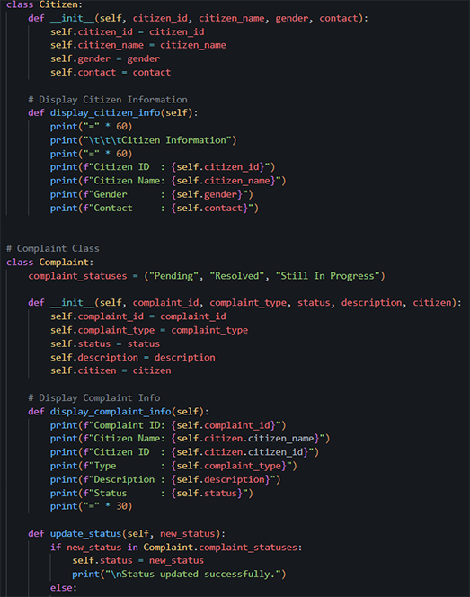
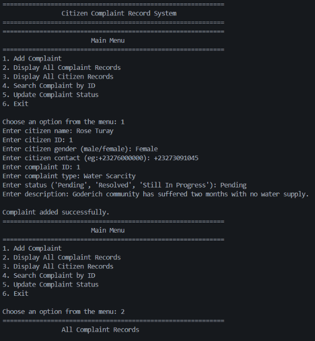

# Citizen Complaint Record System

## About the Project

This is a Python terminal-based application that keeps all filed complaints inside a Python list, with each entry being a Complaint object that also references its linked Citizen object.

Many complaints from citizens are written in notebooks, on loose papers, or passed on verbally, so they are easily lost or forgotten. This project is a simple digital solution that stores every complaint in one place, checks that the information entered is valid, and lets officers track each complaint from start to finish.

It supports **SDG 16: Peace, Justice and Strong Institutions** (targets 16.6 and 16.7) by promoting transparent, responsive and accountable institutions.

## Data Confidentiality

The project relies on made-up citizen details purely for illustration. It does not collect or retain sensitive personal data such as passwords, bank details, home addresses, medical records, or financial information.

## Open Source

This project is open-source and hosted on GitHub, intended for learning and educational use.

## Usability and Inclusivity

The program relies on straightforward Python logic and plain, readable console messages so that complaint records are easy for anyone to follow.

## Modular and Reusable Design

The code is split into distinct classes for citizens, complaints, and the overall complaint system. Methods can be reused to add new complaints, display complaint records, display citizen records, search for a complaint by ID, and update a complaint's status.

## Getting Started

### Prerequisites

- Python 3.6 or higher. Check your version:

```bash
python --version
```

### Installation

1. Clone the repository

```bash
git clone https://github.com/franklyna-nylander/Citizen-Complaint-Record-System.git
```

2. Move into the project folder

```bash
cd Citizen-Complaint-Record-System
```

3. Run the program

```bash
python main.py
```

## Screenshots

### Source Code



### Terminal Output



## Author

**Author's name:** Franklyna Fatmata Nylander

**Student ID:** 905006245
